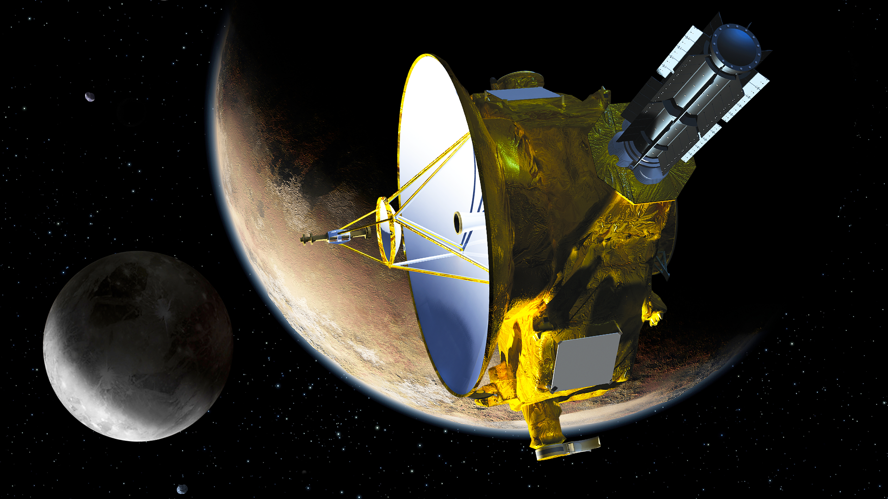
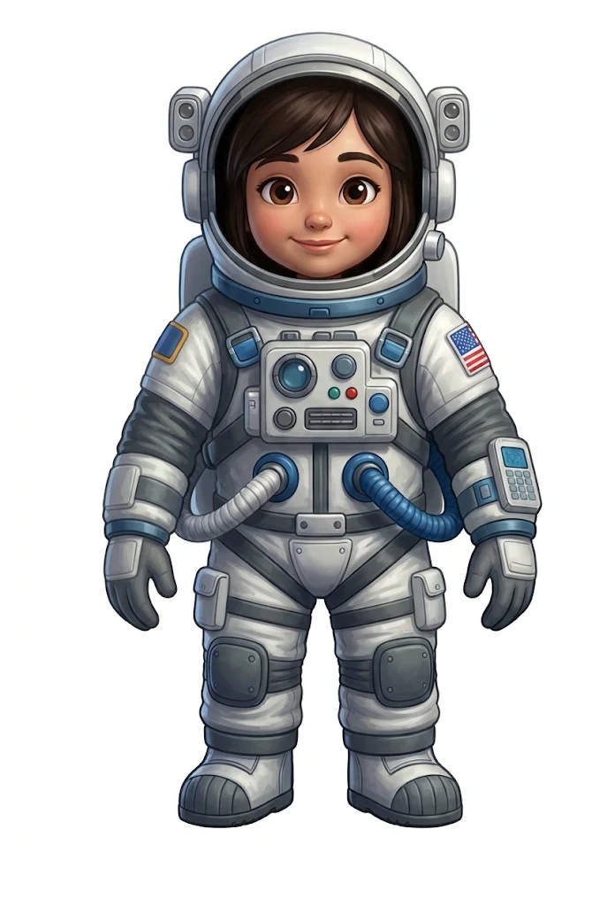
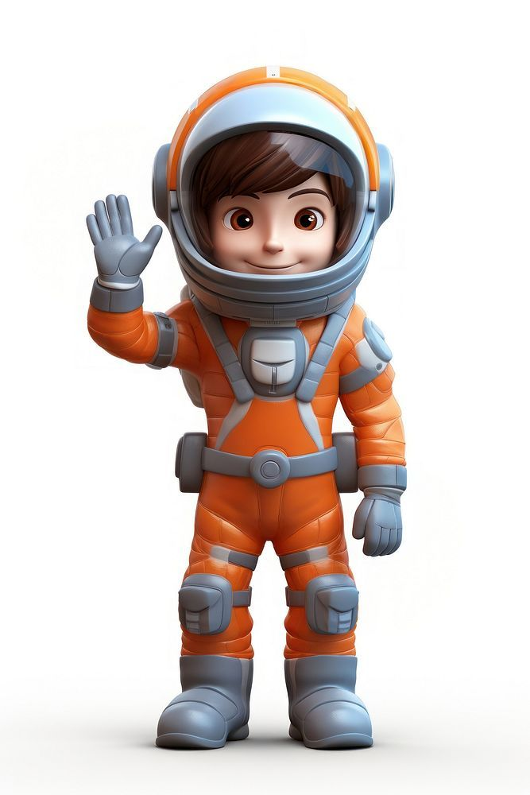
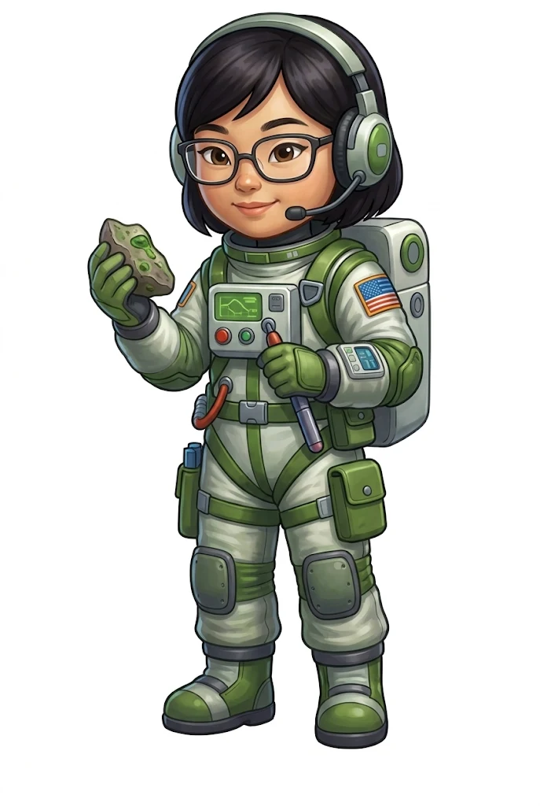

<div align="center">

# 🚀 MissionCraft

### Design. Simulate. Learn.

**An interactive space-mission design game where every engineering choice changes the mission.**

[](https://mission-craft-neuru-volex-ten.vercel.app)
[](https://react.dev/)
[](https://www.typescriptlang.org/)
[](https://vite.dev/)
[](https://www.spaceappschallenge.org/)

<br/>



<br/>

**[Launch MissionCraft](https://mission-craft-neuru-volex-ten.vercel.app) · [Explore the repository](https://github.com/shahzamanjatoi/MissionCraft_NeuruVolex) · [▶ Watch the included hero video](./public/hero.mp4)**

</div>

---

## 🌌 What is MissionCraft?

Space missions are built around trade-offs. A spacecraft needs enough propulsion to reach its destination, enough power to operate its instruments, enough battery capacity to survive eclipses, and a communication system capable of sending scientific data home.

**MissionCraft makes those decisions interactive.**

Built by **Team Neuru Volex** for the **NASA Space Apps Challenge 2026**, MissionCraft is an educational space-mission design and simulation experience. Players choose a destination, select a launch vehicle, configure spacecraft systems, pass pre-flight checks, and follow a simulated mission through its operational phases.

The goal is not simply to get a high score. It is to understand *why* a mission design succeeds, struggles, or fails.

## 🛰️ Explore the mission

<div align="center">

| 01 · DESIGN | 02 · LAUNCH | 03 · FLIGHT | 04 · DEBRIEF |
|:---:|:---:|:---:|:---:|
| Configure the mission | Check readiness | Follow the simulation | Learn from the outcome |
| Target, rocket and spacecraft | GO / NO-GO checks | 3D scene and telemetry | Score, grade and next level |

</div>

### 1. Choose a destination

Plan missions to four progressively challenging destinations:

- **Low Earth Orbit (LEO)** — the starting mission.
- **Geostationary Orbit (GEO)** — a higher Earth orbit used by many communication and weather satellites.
- **The Moon** — a lunar-orbit mission and a central project scenario.
- **Mars** — the most demanding destination in the current progression.

Destinations unlock as missions are successfully completed.

### 2. Build the spacecraft

Choose a launch vehicle and configure the spacecraft to match the target.

| System | Player choices |
|---|---|
| Launch vehicle | Light, Medium and Heavy launchers |
| Propulsion | Monopropellant, Bipropellant and Cryogenic engines |
| Communications | Low-, medium- and high-gain antennas |
| Science payload | Camera, laser altimeter, thermal radiometer, spectrometer and magnetometer |
| Spacecraft parameters | Body mass, propellant mass, solar-array area and battery capacity |

A 3D spacecraft preview changes with the selected spacecraft configuration.

### 3. Pass the pre-flight checks

Before launch, MissionCraft evaluates the design and displays a **GO / NO-GO** status.

The current engineering checks include:

- **Delta-v:** Is the available propulsion capability sufficient for the selected destination?
- **Mass:** Is the spacecraft within the selected launch vehicle's payload capacity?
- **Power:** Can the solar arrays generate enough power for the spacecraft load?
- **Battery:** Is there enough usable stored energy for the modeled eclipse period?
- **Communications:** Does the simplified link-budget calculation meet the minimum margin?
- **Cost:** What is the estimated in-game mission cost?

The engineering evaluation also produces a score and warnings that help players identify what needs to change.

### 4. Follow the mission in 3D

The flight experience includes an interactive Three.js scene with:

- Earth, Moon or Mars as the selected destination body.
- A star field and Sun lighting.
- A spacecraft and orbital trajectory visualization.
- Camera controls for orbiting, panning and zooming.
- Selectable planetary objects with short information panels.
- A mission timeline with play, pause, reset and seek controls.

The telemetry overlay displays mission information such as:

- Mission phase and elapsed time.
- Battery charge.
- Solar power generation.
- Communication availability.
- Eclipse status.
- Science data transmitted.

### 5. Replay, debrief and improve

The mission simulation models a **24-hour mission window** and records telemetry as the spacecraft progresses through:

`Launch → Deployment → Transfer → Arrival → Science Operations → Data Communication → Completion`

The simulation can also model operational events such as:

- Entering and leaving an eclipse.
- Losing and restoring communication.
- Battery depletion and mission failure conditions.
- Science-data generation, storage and downlink.

At the end, the debrief presents the mission outcome, score, grade, stars, failure reasons and progression status. Players can replay the flight, redesign the spacecraft or continue to the next unlocked destination.

---

## 🧮 Engineering model

MissionCraft uses simplified educational calculations to make engineering trade-offs visible during gameplay.

| Area | What the model evaluates |
|---|---|
| Propulsion | Available delta-v using the rocket equation |
| Orbital mechanics | Hohmann-transfer and patched-conic-style delta-v estimates for destination targets |
| Mass budget | Dry mass, instrument mass, propellant and launch payload margin |
| Power budget | Solar generation, instrument load, housekeeping load and eclipse battery reserve |
| Communications | A simplified X-band link budget and link margin |
| Mission cost | Game-balance cost estimate based on launcher and spacecraft mass |
| Mission score | Weighted score based on feasibility, engineering margins and estimated cost |

The model is intentionally simplified for learning and gameplay. It is not a replacement for professional mission-design or flight-dynamics software.

## 🔭 NASA science and mission references

MissionCraft includes a science and reference area that connects the gameplay to real missions, instruments and mission-design resources. The simulator's reference carousel can show material relevant to the selected destination and design stage.

### NASA resources included in the project

- [Lunar Reconnaissance Orbiter (LRO)](https://science.nasa.gov/mission/lro/)
- [LRO spacecraft and instruments](https://science.nasa.gov/mission/lro/spacecraft-and-instruments/)
- [Lunar Orbiter Laser Altimeter (LOLA)](https://science.nasa.gov/mission/lro/lola/)
- [Diviner Lunar Radiometer Experiment](https://www.jpl.nasa.gov/missions/diviner-lunar-radiometer-experiment-dlre/)
- [NASA CubeSat Launch Initiative resources](https://www.nasa.gov/kennedy/launch-services-program/cubesat-launch-initiative/cubesat-launch-initiative-resources/)
- [NASA Ames mission-design and concept-maturity resources](https://www.nasa.gov/ames-engineering/spaceflight-division/mission-design-center/about-our-studies/)

The simulator also includes educational summaries of real missions such as Landsat 8, Hubble, GOES, Lunar Prospector, LRO, Mars Odyssey and Mars Reconnaissance Orbiter.

**Important:** These are linked references and educational comparisons in the current source code. This repository does not demonstrate a live NASA API data-ingestion pipeline, and the engineering model should not be described as NASA-validated.

---

## 🧰 Built with

<div align="center">

| Front end | 3D and animation | Development and testing |
|---|---|---|
| React 19 | Three.js | Vite 8 |
| TypeScript | React Three Fiber | Vitest |
| Tailwind CSS 4 | Drei | ESLint |
| Lucide React | Framer Motion | npm |

</div>

### How the code is organized

```text
MissionCraft/
├── public/
│   ├── hero.mp4
│   ├── textures/
│   └── team/
├── src/
│   ├── 3d/
│   │   ├── components/       # 3D canvas, telemetry HUD and timeline
│   │   ├── controls/         # Scene camera controls
│   │   ├── hooks/            # Mission-scene playback state
│   │   ├── objects/          # Planets, spacecraft, trajectory and stars
│   │   ├── scenes/           # Assembled 3D mission scene
│   │   └── utils/            # Scene and orbit helpers
│   ├── components/           # Simulator phases and interface components
│   ├── data/                 # Targets, launchers, instruments and NASA refs
│   ├── engine/               # Propulsion, orbit, mass, power, comms and scoring
│   ├── pages/                # Home, team and contact pages
│   ├── simulation/           # Mission phases, events, replay and telemetry
│   ├── store/                # Game state and reducer
│   └── types/                # Shared TypeScript types
├── package.json
└── vite.config.ts
```

---

## ⚡ Run it locally

### Requirements

- Node.js **22.12 or newer** (or a compatible newer supported release).
- npm.
- Git.

### 1. Clone the repository

```bash
git clone https://github.com/shahzamanjatoi/MissionCraft_NeuruVolex.git
cd MissionCraft_NeuruVolex
```

### 2. Install dependencies

```bash
npm install
```

### 3. Start the development server

```bash
npm run dev
```

Open the local URL printed in the terminal (Vite commonly uses `http://localhost:5173`).

### Available commands

| Command | Purpose |
|---|---|
| `npm run dev` | Start the local development server |
| `npm run build` | Type-check and create a production build |
| `npm run preview` | Preview the production build locally |
| `npm test` | Run the Vitest test suite |
| `npm run lint` | Run ESLint |

---

## 👩‍🚀 Meet the team

**Team Neuru Volex** · NASA Space Apps Challenge 2026

<div align="center">
<table>
  <tr>
    <td align="center">
      <br/>
      <strong>Shahzaman</strong>
    </td>
    <td align="center">
      <br/>
      <strong>Alisha</strong>
    </td>
    <td align="center">
      <br/>
      <strong>Yousaif</strong>
    </td>
    <td align="center">
      <br/>
      <strong>Zara</strong>
    </td>
  </tr>
</table>
</div>

---

## ⚠️ Scope and limitations

MissionCraft is an **educational prototype** designed to help users explore mission-design concepts.

- Orbital and propulsion calculations are simplified estimates for gameplay.
- The communications link budget is a simplified model, not a complete operational link analysis.
- Mission-cost values are game-balance estimates, not real mission quotations.
- The mission timeline is a simulated scenario, not a prediction of an actual spacecraft flight.
- NASA resources are provided as references; their inclusion does not imply NASA endorsement of MissionCraft.
- The current repository is a client-side application and does not include a production account system or server-side mission database.

Do not use MissionCraft outputs for real spacecraft design, launch decisions or operational flight planning.

## 🙏 Acknowledgements

We are grateful to NASA and the public mission, instrument and educational resources that help make space science accessible. MissionCraft was created to encourage curiosity about the engineering decisions behind exploring our Solar System.

---

<div align="center">

### Every mission starts with a design.

**MissionCraft — Design. Simulate. Learn.** 🚀

[**Play MissionCraft**](https://mission-craft-neuru-volex-ten.vercel.app) · [GitHub Repository](https://github.com/shahzamanjatoi/MissionCraft_NeuruVolex)

</div>
